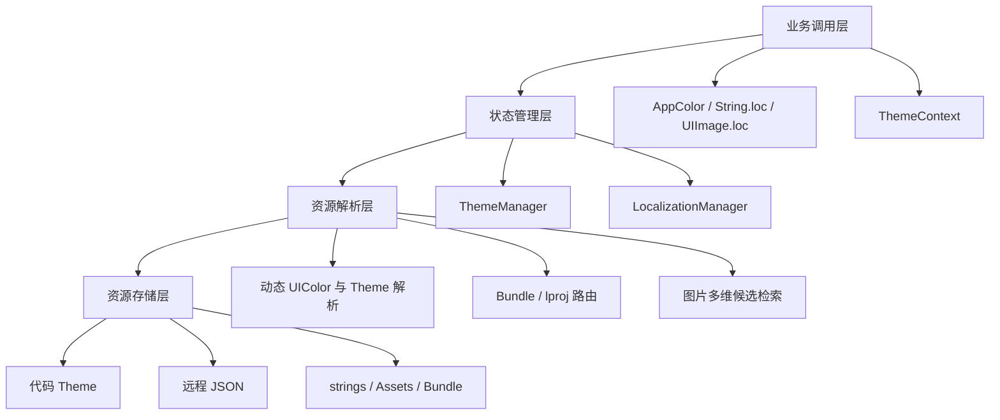
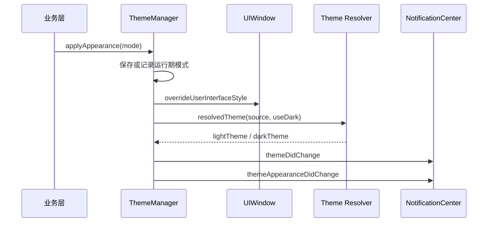
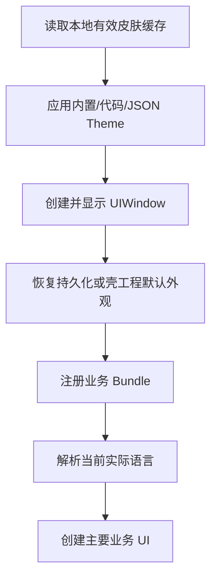

---

title:  "从颜色切换到资源路由：ResourceKit 主题与多语言框架技术解析"
date:   2026-07-24
desc: "系统介绍一套面向组件化 iOS App 的主题、多语言和资源检索框架。内容不仅包含接入方式，也会展开协议设计、运行时解析、Bundle 路由、远程皮肤、跨端同步以及实际工程中容易忽略的边界问题"
categories: [Tech, Study]
tags: [iOS, 多语言, 主题]


---


# 从颜色切换到资源路由：ResourceKit 主题与多语言框架技术解析

> 系统介绍一套面向组件化 iOS App 的主题、多语言和资源检索框架。内容不仅包含接入方式，也会展开协议设计、运行时解析、Bundle 路由、远程皮肤、跨端同步以及实际工程中容易忽略的边界问题。

> 文中的 `ResourceKit`、`ThemeManager`、`AppColor`、`LocalizationManager` 和示例模块名均为脱敏后的通用名称，不对应内部仓库或真实业务组件名称。

## 一、为什么主题和多语言应该放在同一个资源层

在单体 App 中，主题切换可能只是替换几个 `UIColor`，多语言也可能只是调用 `NSLocalizedString`。进入组件化工程后，问题会迅速复杂起来：

- 同一业务组件可能被多个品牌 App 复用；
- 每个品牌都有浅色和深色色板；
- 图片可能同时受语言、皮肤和明暗模式影响；
- 资源可能位于主工程、静态库 Bundle 或动态 Framework；
- 用户可以在运行时切换语言、皮肤和外观；
- 皮肤配置可能由服务端下发；
- H5 和 Flutter 需要获得与 Native 一致的主题上下文。

如果颜色、图片和文字分别实现自己的状态管理，很容易出现“文字已经切换、图片仍是旧语言”“Window 已固定浅色、跨端却收到 system”“深色色板生效但图片仍使用浅色后缀”等状态不一致。

ResourceKit 的核心思路是将这些能力统一为资源解析问题：

```text
业务输入
├── 当前语言 language
├── 当前皮肤 identifier
└── 当前明暗 scheme
        ↓
统一资源层 ResourceKit
├── 颜色 Theme
├── 文本 .strings
└── 图片 Asset / Bundle
        ↓
UIKit、H5、Flutter 获得一致结果
```

其中，皮肤和外观是两个独立维度：

- **皮肤 identifier**：表达品牌身份，例如 `main`、`brand_a`；
- **外观 appearance/scheme**：表达用户偏好和当前实际明暗，例如 `system`、`light`、`dark`。

同一皮肤的浅色 Theme 和深色 Theme 应共享稳定的 `identifier`，通过 `colorScheme` 区分明暗。

---

## 二、整体架构

ResourceKit 可以分成四层：



常用入口保持足够简单：

```swift
titleLabel.textColor = AppColor.primaryText
view.backgroundColor = AppColor.pageBackground

titleLabel.text = "device_title".loc("DeviceCenter")
imageView.image = UIImage.loc("DeviceCenter", key: "icon_home")
```

复杂性被收敛在框架内部，而不是分散到每个业务页面。

---

## 三、主题模型：将皮肤与外观解耦

### 3.1 三个不同但容易混淆的概念

主题框架中有三个核心状态：

```swift
public enum ThemeAppearanceMode: String {
    case system
    case light
    case dark
}

public enum ThemeColorScheme: String, Codable {
    case light
    case dark
}
```

它们分别表示：

| 概念 | 示例 | 含义 |
| --- | --- | --- |
| `identifier` | `brand_a` | 稳定的皮肤/品牌身份 |
| `appearanceMode` | `system` | 用户选择或业务设置的外观偏好 |
| `colorScheme` | `dark` | 当前色板自身的实际明暗属性 |

例如用户选择跟随系统，当前系统为深色：

```text
identifier    = brand_a
appearanceMode = system
colorScheme    = dark
```

不能把深色信息编码进 `identifier`，否则同一皮肤会被错误拆成两个身份，图片检索和服务端皮肤选择也会变得混乱。

### 3.2 ThemeProtocol 协议的分层

`ThemeProtocol` 不是单纯的颜色集合，而是由四类能力组成：

```text
ThemeProtocol
├── 公共基础色
├── 派生色
├── 业务语义色
└── APP/组件专属色 customColors
```

#### 公共基础色

基础色是需要独立配置、无法稳定从其他颜色推导的公共色板，例如：

```swift
var primary: UIColor { get set }
var text_high: UIColor { get set }
var line: UIColor { get set }
var bg_Selago: UIColor { get set }
```

只有所有 App 都能理解的稳定公共 token 才应加入协议。

#### 派生色

派生色通过协议扩展计算，Theme 无需重复存储：

```swift
public var primary_1: UIColor {
    primary.withAlphaComponent(0.1)
}

public var link: UIColor {
    primary
}
```

这减少了 JSON 字段数量，也避免同一透明度规则在多个 Theme 中出现不一致。

#### 业务语义色

业务页面不应关心某个十六进制色值，而应表达 UI 用途：

```swift
public var pageBackground: UIColor { bg_Selago }
public var cardBackground: UIColor { cell_white }
public var primaryText: UIColor { text_high }
public var accent: UIColor { primary }
public var separator: UIColor { line }
```

语义色默认映射到基础色，具体 Theme 可以覆盖。例如某个深色皮肤需要卡片使用特殊灰色，只覆盖 `cardBackground` 即可。

#### APP/组件专属色

如果 APP1 新增一个角标颜色，不应迫使 APP2 的所有 Theme 修改公共协议。ResourceKit 通过命名空间 Key 提供扩展槽：

```swift
public struct ThemeColorKey: RawRepresentable, Hashable, Codable {
    public let rawValue: String

    public init(rawValue: String) {
        self.rawValue = rawValue
    }
}

extension ThemeColorKey {
    static let app1BadgeBackground =
        Self(rawValue: "app1.badgeBackground")
}
```

相关 Theme 只需配置自己的字典：

```swift
var customColors: [ThemeColorKey: UIColor] {
    [.app1BadgeBackground: UIColor(hexInt: 0xFF5A5F)]
}
```

业务取色时提供安全兜底：

```swift
let color = AppColor.color(
    for: .app1BadgeBackground,
    fallback: AppColor.accent
)
```

这个设计避免公共协议随单一业务需求持续膨胀。

### 3.3 明暗 Theme 的关联

浅色 Theme 通过 `darkTheme` 关联同一皮肤的深色色板：

```swift
struct BrandLightTheme: ThemeProtocol {
    let identifier = "brand_a"
    let colorScheme = ThemeColorScheme.light
    let darkTheme: ThemeProtocol? = BrandDarkTheme()
}

struct BrandDarkTheme: ThemeProtocol {
    let identifier = "brand_a"
    let colorScheme = ThemeColorScheme.dark
    let darkTheme: ThemeProtocol? = nil
}
```

自定义 Theme 没有声明 `darkTheme` 时，协议默认实现会回退到内置 `main_dark`。这样旧 Theme 即使只提供浅色实现，也不会在进入深色模式时完全失效。

---

## 四、ThemeManager：状态来源、解析与切换

### 4.1 源 Theme 与当前 Theme

Manager 内部同时保存：

```text
sourceTheme_  = 当前皮肤的源 Theme，通常是浅色入口
currentTheme_ = 根据 appearanceMode 解析后的实际色板
```

外观变化只切换 `currentTheme_`，不会丢失源皮肤身份。其核心解析逻辑可以概括为：

```swift
private func resolvedTheme(
    from source: ThemeProtocol,
    useDarkAppearance: Bool
) -> ThemeProtocol {
    guard useDarkAppearance else { return source }
    guard source.colorScheme != .dark else { return source }
    return source.darkTheme ?? source
}
```

### 4.2 默认外观与显式选择的优先级

当前实现没有把“框架默认 system”强加给所有壳工程，而是按以下优先级解析：

```text
本次进程 applyAppearance(..., persist: false)
    > 用户持久化选择
    > 壳工程 UIUserInterfaceStyle
    > system
```

壳工程配置映射为：

| `UIUserInterfaceStyle` | 默认模式 |
| --- | --- |
| `Light` | `.light` |
| `Dark` | `.dark` |
| `Automatic` 或缺失 | `.system` |

这样，不提供外观选择的固定浅色 App 无需额外写初始化逻辑；支持跟随系统的 App 则必须将 Target 的 User Interface Style 设置为 Automatic。

这里有一个重要设计细节：壳工程默认值不会自动写入 UserDefaults。否则未来壳工程从 Light 改为 Automatic，历史用户仍会永久残留 `.light`。

### 4.3 应用外观

```swift
ThemeManager.shared.applyAppearance(.system)
ThemeManager.shared.applyAppearance(.light)
ThemeManager.shared.applyAppearance(.dark)
```

调用流程是：



`persist: false` 表示只在本次进程内生效：

```swift
ThemeManager.shared.applyAppearance(.dark, persist: false)
```

运行期覆盖值会在 App 重新进入前台时继续生效，但不会污染用户长期偏好。

### 4.4 跟随系统的 Probe

框架会向 Window 安装一个轻量 `SystemAppearanceProbeView`，在系统外观变化时同步非动态资源和全局 Theme：

```text
系统 light/dark 变化
    ↓
Window traitCollection 变化
    ↓
SystemAppearanceProbeView
    ↓
syncAppearance(resolvedStyle:)
    ↓
刷新 currentTheme + 发送通知
```

需要注意：如果壳工程声明了：

```text
UIUserInterfaceStyle = Light
```

即使 `appearanceMode` 写成 `.system`，Window 的实际 trait 仍会保持 Light，系统切换不会传递到 View 层。要真正跟随系统，壳工程必须使用 Automatic。

在 iOS 17 及以上，UIKit 推荐使用 `registerForTraitChanges` 监听指定 trait；旧版 `traitCollectionDidChange` 仍可作为 iOS 13～16 的兼容路径。无论使用哪种入口，都应以实际 `userInterfaceStyle` 和已保存的上一次 style 去重，而不是假设每次 trait 回调都代表明暗变化。

---

## 五、动态 UIColor：为什么已经赋值的颜色还能变化

### 5.1 静态颜色的问题

传统写法返回的是取色瞬间的普通 UIColor：

```swift
label.textColor = ThemeManager.shared.currentTheme.primaryText
```

如果 Label 保存的是浅色 RGB，系统变暗后它并不知道应该重新读取 Theme。

### 5.2 AppColor 动态代理

ResourceKit 为 `AppColor` 提供了实现 `ThemeProtocol` 的动态代理。每个标准 token 最终都包装成：

```swift
UIColor { traitCollection in
    let theme = ThemeManager.shared.theme(for: traitCollection)
    return theme.primary
}
```

因此下面的调用语法不变：

```swift
label.textColor = AppColor.primaryText
view.backgroundColor = AppColor.pageBackground
imageView.tintColor = AppColor.navTint
```

但 UIKit 保存的不再是固定 RGB，而是一个动态颜色解析器。Window 的 trait 从 Light 变为 Dark 时，UIKit 会重新解析该 UIColor。

代理对基础色、派生色和业务语义色逐项转发到最终 Theme，而不是只从 `primary` 再推导所有颜色，因此具体 Theme 对 `accent`、`cardBackground` 等字段的 override 不会丢失。

iOS 11/12 不支持动态 UIColor，框架会回退到调用当时的静态颜色。

### 5.3 动态 UIColor 的边界

动态 UIColor 只有在 UIKit 保留 UIColor 对象时才能自动解析。以下转换会丢失动态能力：

```swift
layer.borderColor = AppColor.separator.cgColor
gradientLayer.colors = [AppColor.primary.cgColor]
let fixed = AppColor.primary.resolvedColor(with: traitCollection)
```

需要主动刷新的场景包括：

- `CGColor`、`CAShapeLayer`、`CAGradientLayer`；
- 使用颜色绘制生成的 UIImage；
- 第三方 SDK 将 UIColor 转换为 RGBA；
- 明暗不变、只切换皮肤；
- APP/组件专属 `customColors` 字典。

这些场景应监听：

```swift
NotificationCenter.default.addObserver(
    self,
    selector: #selector(refreshTheme),
    name: .themeDidChange,
    object: nil
)
```

---

## 六、远程 JSON 主题

### 6.1 单色板下发

JSON Theme 将服务端字典解析为 `JSONTheme`：

```json
{
  "identifier": "brand_a",
  "appearance": "light",
  "primary": "#0551D6",
  "text_high": "#222222",
  "bg_Selago": "#F7F7F7",
  "customColors": {
    "app1.badgeBackground": "#FF5A5F"
  }
}
```

支持：

- `#RRGGBB`；
- `RRGGBB`；
- `#RRGGBBAA`，最后两位表示透明度。

非法颜色会被忽略，缺失字段回退内置默认 Theme，避免一项配置错误导致整个皮肤不可用。

```swift
ThemeManager.shared.applyTheme(fromJSON: data)
```

如果只下发浅色 JSON，深色默认使用传入的 `darkTheme`，未传时回退 `main_dark`。

### 6.2 Light/Dark 成对下发

```swift
let success = ThemeManager.shared.applyTheme(
    fromJSON: lightData,
    darkJSONData: darkData
)
```

框架会：

1. 校验浅色和深色 JSON 的显式 identifier 是否一致；
2. 强制浅色配置的 `appearance = light`；
3. 强制深色配置的 `appearance = dark`；
4. 让两套色板共享稳定 identifier；
5. 将深色 Theme 挂到浅色 Theme 的 `darkTheme`。

服务端推荐下发皮肤目录，业务下载并校验 JSON 与资源包，成功后先落本地缓存，再应用。启动阶段读取本地有效缓存，不应等待网络请求，否则容易出现首帧闪烁。

---

## 七、图片资源：语言、皮肤和明暗的组合检索

图片同时受三个维度影响：

```text
key → language → identifier → scheme
```

唯一命名顺序固定不变。例如：

```text
icon_home_zh-CN_brandA_dark
```

框架按“维度数量从多到少”降级；相同维度数量下，优先保留语言，其次皮肤身份，最后明暗：

| 优先级 | 规则 |
| --- | --- |
| 1 | `key + language + identifier + scheme` |
| 2 | `key + language + identifier` |
| 3 | `key + language + scheme` |
| 4 | `key + identifier + scheme` |
| 5 | `key + language` |
| 6 | `key + identifier` |
| 7 | `key + scheme` |
| 8 | `key` |

每个候选名先在当前业务模块 Bundle 查找，再从主工程查找：

```swift
for imageName in candidates {
    if let image = UIImage(
        named: imageName,
        in: moduleBundle,
        compatibleWith: nil
    ) {
        return image
    }

    if let image = UIImage(named: imageName) {
        return image
    }
}
```

业务统一使用：

```swift
imageView.image = UIImage.loc(
    "DeviceCenter",
    key: "icon_home"
)
```

单色 SVG/Vector 图标推荐使用 Template Image，通过 `AppColor` 设置 `tintColor`；多色插画、Logo 或图形本身有差异时，再使用上述资源后缀。

---

## 八、多语言状态模型

### 8.1 设置语言与实际语言

多语言框架区分：

- 用户设置语言：可能是 `.auto`；
- 当前实际语言：一定是一个具体可用语言。

```swift
public enum LanguageType: String, CaseIterable {
    case auto = "system"
    case en = "en"
    case zh_CN = "zh-Hans"
    case zh_TW = "zh-Hant"
    case fr_FR = "fr"
    // ...
}
```

当用户选择跟随系统时：

1. 读取 `Locale.preferredLanguages.first`；
2. 将系统语言映射到 `LanguageType`；
3. 检查主工程是否包含对应 localization；
4. 不支持时回退英文。

需要注意当前版本的接口命名与实现存在一个容易误解的细节：`currentSetLanguage()` 的注释表示跟随系统时返回 `.auto`，但其实现实际转调了 `currentLanguage()`，返回的是解析后的具体语言。判断用户是否选择跟随系统，应使用 `followSystemLanguage()`；获取当前实际资源语言使用 `currentLanguage()`。后续版本适合将“用户偏好”和“实际语言”拆成两个命名更明确的只读属性。

这里要区分两个字符串：

```text
rawValue：用于寻找 lproj，例如 zh-Hans
sign()：用于接口或图片后缀，例如 zh-CN
```

混用二者会导致 lproj 路径或图片名不匹配。

### 8.2 持久化与缓存

框架保存两个状态：

```text
AppCurrentLanguageKey      当前具体语言
AppFollowSystemLanguageKey 是否跟随系统
```

首次安装默认跟随系统。为了避免高频资源读取时不断解析语言，`m_curLanguage` 会缓存当前实际语言。

切换语言时必须打破所有依赖缓存：

```swift
m_curLanguage = nil
localizedResourceMap.removeAll()
m_curLanguage = goLanguage
postChangeNotification()
```

这是多语言运行时切换能够生效的关键。`LocalizedResource` 内部持有具体的 `lprojBundle`；如果只修改语言值而不清空资源对象，后续读取仍会落到旧语言目录。

业务页面监听：

```swift
NotificationCenter.default.addObserver(
    self,
    selector: #selector(refreshLanguage),
    name: LocalizationManager.languageDidChangeNotification,
    object: nil
)
```

---

## 九、组件化 Bundle 路由

### 9.1 为什么不能只使用 Bundle.main

组件的 `.strings` 和图片可能以多种形式进入最终 App：

```text
主工程资源
静态库 + 独立 Bundle
动态 Framework + 独立 Bundle
动态 Framework 内置资源
Resources/Localized 多一层目录
```

因此，LocalizationManager 以模块名创建 `LocalizedResource`：

```swift
let resource = LocalizationManager.resourceBundle(
    name: "DeviceCenter"
)
```

资源对象中保存：

```text
moduleBundle  模块图片等资源所在 Bundle
lprojBundle   当前语言 strings 所在 Bundle
enLprojBundle 英文 fallback Bundle
```

### 9.2 Bundle 查找顺序

当前实现依次尝试：

1. App 根目录中的 `Module.bundle`；
2. `Module.bundle/Localized/<language>.lproj`；
3. 静态库独立 Bundle；
4. `Frameworks/Module.framework/Module.bundle`；
5. `Frameworks/Module.framework`；
6. 最终回退 `Bundle.main`。

这让同一组件既可以作为源码/静态库集成，也可以作为动态 Framework 集成，而业务调用方式保持不变。

资源对象按模块名缓存在：

```swift
private var localizedResourceMap: [String: LocalizedResource]
```

避免每次取文案或图片都遍历文件路径。

---

## 十、字符串本地化与英文降级

### 10.1 基础调用

```swift
let title = "device_title".loc("DeviceCenter")
```

内部查找流程：

```text
当前语言 Module.strings
    ↓ 未找到
英文 en.lproj/Module.strings
    ↓ 未找到
原始 key
```

框架使用自定义 sentinel 判断当前语言表中是否存在 Key，避免把“返回 key”误认为真实翻译：

```swift
let noResultValue = key + ".undefined"
let value = NSLocalizedString(
    key,
    tableName: moduleName,
    bundle: lprojBundle,
    value: noResultValue,
    comment: ""
)
```

### 10.2 类型安全的字符串插值

普通字符串插值会先生成完整中文字符串，导致无法以稳定 key 查找翻译。ResourceKit 通过 `ExpressibleByStringInterpolation` 将字面量和参数拆开：

```swift
let phone = "12345"
let result = LocalizationBridge.locByInterpolation(
    bundleName: "DeviceCenter",
    strInterpolation: "如需要帮助,请拨打 \(phone)"
)
```

生成的查找 key 是：

```text
如需要帮助,请拨打 %@
```

参数则单独保存在 `[CVarArg]`，查到翻译后再调用 `String(format:arguments:)`：

```strings
"如需要帮助,请拨打 %@" = "For assistance, please call %@";
```

内置插值映射包括：

| Swift 类型 | 格式符 |
| --- | --- |
| `Int` | `%ld` |
| `Double` | `%f` |
| `String` | `%@` |
| `URL` | `%@` |

还支持数字精度和日期格式化插值。

---

## 十一、主题与多语言如何协同

颜色、文字和图片的状态变化并不完全相同：

| 变化 | 动态 UIColor | 文案 | 主题图片 |
| --- | --- | --- | --- |
| 系统 Light/Dark | UIKit 可自动解析标准 UIColor | 不变 | 需要重新检索 |
| 切换皮肤 | 需要主题通知刷新 | 不变 | 需要重新检索 |
| 切换语言 | 不变 | 需要重新读取 | 需要重新检索 |

因此复杂页面可以分别响应两个通知：

```swift
NotificationCenter.default.addObserver(
    self,
    selector: #selector(refreshTheme),
    name: .themeDidChange,
    object: nil
)

NotificationCenter.default.addObserver(
    self,
    selector: #selector(refreshLanguage),
    name: LocalizationManager.languageDidChangeNotification,
    object: nil
)
```

如果页面图片同时依赖语言和主题，两种回调都应重新调用 `UIImage.loc`，不要缓存最终图片名。

---

## 十二、H5 与 Flutter 的统一主题上下文

ThemeContext 向跨端暴露四个稳定字段：

```swift
public struct ThemeContext {
    let version: Int
    let skinIdentifier: String
    let appearanceMode: ThemeAppearanceMode
    let resolvedScheme: ThemeColorScheme
}
```

转换后的字典为：

```json
{
  "theme": "dark",
  "skin": "brand_a",
  "themeMode": "system",
  "themeVersion": 1
}
```

- `theme`：当前真正生效的 Light/Dark，页面渲染应使用它；
- `skin`：稳定皮肤身份；
- `themeMode`：用户偏好或壳工程默认策略；
- `themeVersion`：跨端协议版本。

H5 URL 通过 `queryItems` 合并，同名参数会被 Native 当前状态替换：

```swift
let themedURL = ThemeManager.shared.themeContext
    .appending(to: originalURL)
```

Flutter 可以在路由 arguments 中传递同一字典，并在运行过程中监听主题变化事件。关键原则是：Native、H5 和 Flutter 不应各自推断皮肤与外观。

---

## 十三、启动时序

推荐启动顺序：



示例：

```swift
LocalizationManager.awake()
LocalizationManager.registerBundle(name: "DeviceCenter")

ThemeManager.shared.setupTheme(BrandLightTheme())

// Window 创建完成后
ThemeManager.shared.applySavedAppearanceIfNeeded()
```

远程主题启动时只读取已经下载并校验成功的本地缓存，不应阻塞等待网络。

---

## 十四、调试与验收

### 14.1 查看实际色值

```swift
ThemeDebug.hex(AppColor.primary)
ThemeDebug.dumpCurrentTheme()
```

完整报告包含：

- 当前 identifier；
- 当前 scheme；
- 基础色；
- 派生色；
- 业务语义色；
- APP/组件专属色。

动态 UIColor 应传入目标 View 的 traitCollection 解析：

```swift
ThemeDebug.hex(
    AppColor.primaryText,
    traitCollection: view.traitCollection
)
```

### 14.2 推荐验收矩阵

| 维度 | 用例 |
| --- | --- |
| 外观 | Light、Dark、System 实时切换 |
| 壳工程 | UIUserInterfaceStyle Light/Dark/Automatic |
| 皮肤 | 内置、代码 Theme、单 JSON、双 JSON |
| 颜色载体 | UIView、UILabel、Tint、CGColor、Gradient、UIImage |
| 语言 | 手动语言、跟随系统、不支持语言回退英文 |
| 集成形式 | 主工程、静态 Bundle、Framework Bundle |
| 图片 | 语言/皮肤/明暗完整组合及逐级降级 |
| 跨端 | H5、Flutter 首次参数和运行时事件 |

---

## 十五、当前实现的边界与演进方向

一个工程化框架不仅要说明“能做什么”，也要明确“暂时不做什么”。

### 15.1 当前边界

- `customColors` 只承载颜色，不承载圆角、字体、间距或 Blur Style；
- 动态 UIColor 无法让 CGColor、渐变和已绘制图片自动变化；
- 图片检索依赖严格命名约定；
- 原始 SVG 的分层运行时改色需要额外 SVG 渲染库；
- 语言和资源缓存是进程内共享状态，建议在主线程执行语言切换；
- 服务端皮肤的下载、签名校验、版本缓存和回滚属于业务基础设施；
- Theme 与语言通知不会自动重建所有第三方 SDK 模型。

### 15.2 推荐演进

1. iOS 17+ 将系统外观监听迁移到 `registerForTraitChanges`；
2. 为 Theme 和多语言状态增加自动化测试矩阵；
3. 将远程皮肤下载、校验、缓存抽象为独立 Skin Repository；
4. 对资源 Bundle 路径建立启动期诊断报告；
5. 为缺失翻译和缺失图片增加可配置的 Debug 断言或埋点；
6. 将语言映射、地区码和接口 sign 进一步数据化；
7. 对并发读取和运行时切换增加明确的 MainActor/线程约束。

---

## 十六、总结

ResourceKit 的价值不只是提供 `AppColor.primary` 或 `"key".loc()` 两个便捷方法，而是建立了一套统一资源模型：

- 皮肤身份与明暗外观解耦；
- 基础色、派生色、语义色和业务专属色分层；
- 动态 UIColor 承接 UIKit 原生 trait 机制；
- 代码 Theme 与服务端 JSON 共用同一协议；
- 语言、皮肤和明暗共同参与图片资源路由；
- 多种组件集成形态共用 Bundle 解析逻辑；
- Native、H5 和 Flutter 使用统一主题上下文。

对于大型组件化 App，真正困难的从来不是“切换一个颜色”或“读取一条翻译”，而是保证所有资源、所有页面、所有技术栈在状态变化后仍然得到一致结果。把主题和多语言提升为统一资源基础设施，正是解决这类一致性问题的关键。
